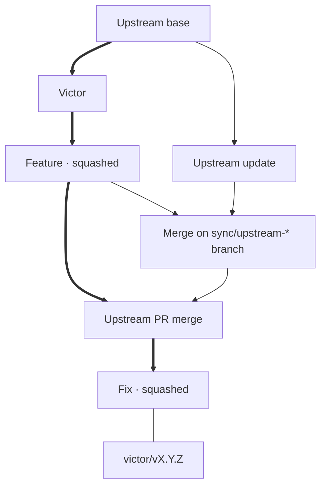

# Maintaining the shared fork

`main` contains Victor and subsequent fork work. **Never rewrite shared main or published release tags.** All changes reach main through PRs to `lingmann/pi-pocket`.

## Two merge rules

- **Feature/fix PRs: Squash and merge.** One reviewed change per commit.
- **Upstream-update PRs: Create a merge commit. Never squash.** Git retains upstream ancestry for the next update.

The complete graph is not linear. Review main with `git log --first-parent --oneline --decorate origin/main`.

Arrows mean **parent → child**; thick arrows trace main's first-parent review path. The tag line is a reference, not ancestry.

## Commit titles on fork main

- **`fork: <description>`** for our features, fixes, docs, and tooling.
- **`upstream: merge upstream/main (<SHA>)`** for upstream-update PRs. The SHA identifies the actual imported commit, not the update branch's version label.

These are PR titles, and they become the subjects of the squash/merge commits on main. Individual feature-branch commits need no prefix; `just pr` supplies the title. `Fork checks` requires the prefix that matches the head branch (`sync/upstream-*` requires `upstream:`, all other branches `fork:`) and reruns when a title is edited. Reserve `sync/upstream-*` for upstream updates, and keep the prefixed subject when merging: the check enforces the prefix, not the merge method.

## Before using mutating recipes

Use a **development checkout, never the checkout serving Pi Pocket**. Install dependencies with `npm ci`; commit changes and finish any Git operation. Don't run concurrent Git operations.

`upstream` is `TannerMidd/pi-pocket`; `origin` fetches and pushes `lingmann/pi-pocket`. Local `main` tracks `origin/main`.

## Daily use

| Command                            | Effect                                                                                                |
| ---------------------------------- | ----------------------------------------------------------------------------------------------------- |
| `just status`                      | Show worktree/tracking state, first-parent fork-main history, and latest local release tag. |
| `just feature voice-fix`           | Fetch fork main and create `$USER/voice-fix` from it.                                                 |
| `just pr "fix voice playback"`     | Push the current branch and open PR with prefix: `fork: fix voice playback`. |
| `just check`                       | Run TypeScript and focused Victor/shared/tooling tests.                                               |
| `just upstream-update v0.13.3`     | Fetch both mains; create `sync/upstream-v0.13.3` from `origin/main` and merge `upstream/main`.        |
| `just release 0.1.0`               | Tag and push only `victor/v0.1.0`, requiring main to match freshly fetched `origin/main`.             |

Start features with `just feature <slug>` before editing. It creates `$USER/<slug>` from freshly fetched `origin/main`, leaving local `main` unchanged. Override the namespace with, for example, `USER=alice just feature voice-fix`.

`just pr "<description>"` publishes the branch and opens the PR. On an upstream-update branch, omit the description.

`just pr` requires an authenticated GitHub CLI (`gh auth login`), a clean non-main branch with at least one commit beyond `origin/main`, and `origin` fetch/push URLs pointing to `lingmann/pi-pocket`. It fetches `origin/main`, requires the branch to include it, and never force-pushes, merges, or publishes tags.

Rerunning is safe: if the fork already has an open PR for the branch, `just pr` prints its URL without pushing or changing the title. After the first push, add reviewed commits with `git push --no-follow-tags origin HEAD` and edit the title on GitHub. If the push succeeded but PR creation failed, rerun `just pr`; it checks for an existing PR first. An upstream-update title comes from the first import merge's second parent, so later commits and a moving `upstream/main` do not change it; a description becomes the PR body.

You can still open PRs manually; give them the prefix above and target the fork's `main`.

Authors may tidy their own branches, not rewrite another developer's shared work.

Release from `main` after `git pull --ff-only` and confirmation that it has passed the required GitHub checks and any manual release checks; `just release 0.1.0` annotates and pushes only the new `victor/vX.Y.Z` tag after its safety guards and never deploys.

## Release versioning

Use **independent Semantic Versioning** for fork releases, tagged `victor/vX.Y.Z`. Choose the bump from changes to the fork, not upstream's version number. Record the incorporated upstream commit and release version, when applicable, in release notes.

For example, starting from `victor/v0.1.0` based on upstream `v0.13.2`:

- A fork-only bug fix becomes `victor/v0.1.1`, still based on upstream `v0.13.2`.
- Adopting new capabilities from upstream `v0.13.3` could become `victor/v0.2.0`. A fixes-only upstream update can be a patch release instead.
