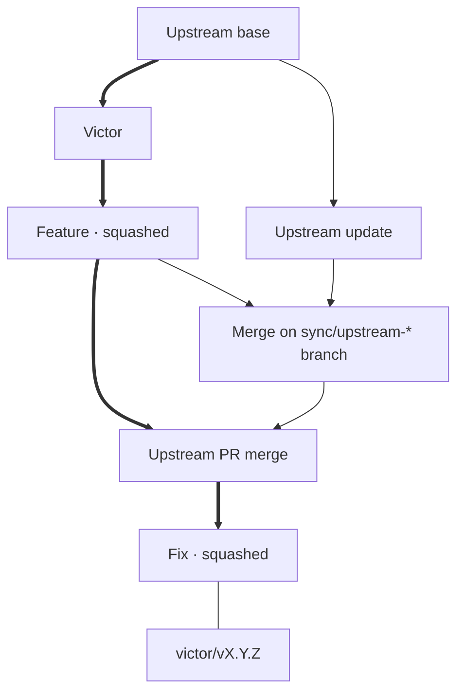

# Maintaining the shared fork

`main` contains Victor and subsequent fork work. **Never rewrite shared main or published release tags.** All changes reach main through PRs to `lingmann/pi-pocket`.

## Two merge rules

- **Feature/fix PRs: Squash and merge.** One reviewed change per commit.
- **Upstream-update PRs: Create a merge commit. Never squash.** Git retains upstream ancestry for the next update.

The complete graph is not linear. Review main with `git log --first-parent --oneline --decorate origin/main`.



Arrows mean **parent → child**; thick arrows trace main's first-parent review path. The tag line is a reference, not ancestry.

## Before using mutating recipes

Use a **development checkout, never the checkout serving Pi Pocket**. Install dependencies with `npm ci`; commit changes and finish any Git operation. Don't run concurrent Git operations.

`upstream` is `TannerMidd/pi-pocket`; `origin` fetches and pushes `lingmann/pi-pocket`. Local `main` tracks `origin/main`.

## Daily use

| Command                        | Effect                                                                                                                          |
| ------------------------------ | ------------------------------------------------------------------------------------------------------------------------------- |
| `just status`                  | Show worktree/tracking state, first-parent fork-main history, and latest local release tag. No fetch.                           |
| `just check`                   | Run TypeScript and focused Victor/shared/tooling tests.                                                                         |
| `just upstream-update v0.13.3` | Fetch both mains; confirm; create `sync/upstream-v0.13.3` from `origin/main` and merge `upstream/main`. No push.                |
| `just release 0.1.0`           | Require clean main matching freshly fetched origin/main; confirm, check, annotate and push only `victor/v0.1.0`. No deployment. |

The update name is a branch label, **not a version pin**; updates always merge upstream/main.

Start features from updated fork main. Authors may tidy their own branches, not rewrite another developer's shared work.

After committing and checking either kind of branch:

```sh
git push -u origin HEAD
gh pr create --repo lingmann/pi-pocket --base main
```

Choose the merge method above. Refresh local main with `git pull --ff-only` before releasing; use a fresh `X.Y.Z` version.

## Release versioning

Use **independent Semantic Versioning** for fork releases, tagged `victor/vX.Y.Z`. Choose the bump from changes to the fork, not upstream's version number. Record the incorporated upstream commit and release version, when applicable, in release notes.

For example, starting from `victor/v0.1.0` based on upstream `v0.13.2`:

- A fork-only bug fix becomes `victor/v0.1.1`, still based on upstream `v0.13.2`.
- Adopting new capabilities from upstream `v0.13.3` could become `victor/v0.2.0`. A fixes-only upstream update can be a patch release instead.

## Checks and recovery

`just check` is a baseline. Add [shared/upstream coverage](victor.md#focused-test-coverage) and manual device checks as needed. [Known failures](../TEST_ISSUES.md) still fail the gate.

For update conflicts, resolve and stage files, then `git merge --continue`; cancel with `git merge --abort`. The update branch and fetched refs remain.

A failed tag push preserves the local tag and prints an explicit retry command. Retry that push, not `just release`; never force an existing remote tag.
