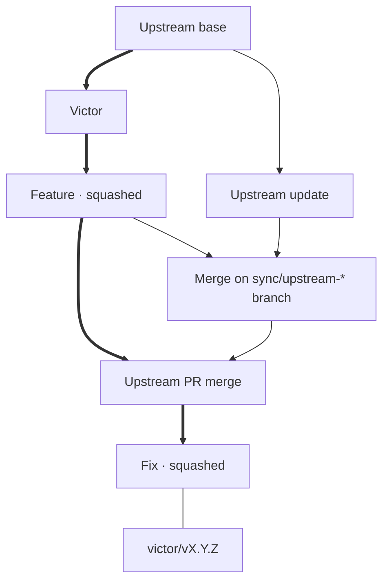

# Maintaining the shared fork

`main` contains Victor and subsequent fork work. **Never rewrite shared main or published release tags.** All changes reach main through PRs to `lingmann/pi-pocket`.

## Two merge rules

- **Feature/fix PRs: Squash and merge.** One reviewed change per commit.
- **Upstream-update PRs: Create a merge commit. Never squash.** Git retains upstream ancestry for the next update.

The complete graph is not linear. Review main with `git log --first-parent --oneline --decorate origin/main`.

Arrows mean **parent → child**; thick arrows trace main's first-parent review path. The tag line is a reference, not ancestry.

## Commit titles on fork main

- **`fork: <description>`** for our features, fixes, docs, and tooling.
- **`upstream: merge upstream/main (<SHA>)`** for upstream-update PRs. The SHA identifies the actual imported commit, not the update branch's version label.

These are PR titles, and they become the subjects of the squash/merge commits on main. Individual feature-branch commits need no prefix; `just pr` supplies the title. `Fork checks` requires the prefix that matches the head branch (`sync/upstream-*` requires `upstream:`, all other branches `fork:`) and reruns when a title is edited. Reserve `sync/upstream-*` for upstream updates, and keep the prefixed subject when merging: the check enforces the prefix, not the merge method.

## Before using mutating recipes

Use a **development checkout, never the checkout serving Pi Pocket**. Install dependencies with `npm ci`; commit changes and finish any Git operation. Don't run concurrent Git operations.

`upstream` is `TannerMidd/pi-pocket`; `origin` fetches and pushes `lingmann/pi-pocket`. Local `main` tracks `origin/main`.

## Running Just recipes

A **recipe** is a named entry in `justfile`, such as `pr`. The command `just pr "fix voice playback"` runs the `pr` recipe, which calls the `scripts/victor/fork.mjs` script.

Run `just` to list recipes. Run `just --usage pr` to see the arguments for `pr`.

Just parses recipe names and arguments before running the script. It assigns words to each recipe's arguments first, then looks for another recipe name:

- `just check repo-status` runs two recipes: `check`, then `repo-status`.
- `just pr check` passes `check` as the PR description; it does not run the `check` recipe.
- `just pr '' check` runs `pr` with an empty description, then runs `check`. The empty description is valid only for upstream-update PRs, and publication happens before the checks.

The `fork.mjs` script validates the argument values. It does not accept flags such as `--help`. Before running Git, it rejects any argument that starts with `-`, ignoring leading whitespace. This includes quoted PR descriptions such as `"  - fix bug"`.

Prefer running one recipe per command. Just rejects unknown recipe names and missing required arguments before any recipe runs. If `fork.mjs` later fails, Just stops, but it does not undo work from earlier recipes.

## Daily use

| Command                        | Effect                                                                                                  |
| ------------------------------ | ------------------------------------------------------------------------------------------------------- |
| `just repo-status`             | Fetch upstream main; show incoming updates, recent fork history, and staged/unstaged/untracked changes. |
| `just feature voice-fix`       | Fetch fork main and create `$USER/voice-fix` from it.                                                   |
| `just pr "fix voice playback"` | Push the current branch and open PR with prefix: `fork: fix voice playback`.                            |
| `just check`                   | Run TypeScript and focused Victor/shared/tooling tests.                                                 |
| `just upstream-update v0.13.3` | Fetch both mains; create `sync/upstream-v0.13.3` from `origin/main` and merge `upstream/main`.          |
| `just release 0.1.0`           | Tag and push only `victor/v0.1.0`, requiring main to match freshly fetched `origin/main`.               |

Before the existing merge confirmation, `just upstream-update` prints a prominent notice, file-status summary, and diff if upstream has incoming changes under `.github/workflows/`, including additions, renames, and deletions. The script compares upstream with the common ancestor of the fetched mains, so fork-only edits are not reported as incoming changes. The diff uses color in an interactive terminal unless `NO_COLOR` is set; redirected output stays plain. It adds no extra prompt and does not change GitHub settings.

Upstream 0.26.0 adds `publish.yml`, which publishes the upstream npm package on a GitHub release or manual dispatch. Keep its YAML unchanged and disable **Publish to npm** in the fork's GitHub Actions settings, as with **Pages**. Do not use it for Victor releases: trusted publishing names the upstream repository, and its `v<package.json version>` tag check does not accept `victor/vX.Y.Z`. The update recipe does not change or verify workflow settings; confirm they are disabled before publishing a fork release.

If an upstream merge stops with conflicts, use the project prompt template `/resolve-upstream`, optionally followed by the release or a review focus, for example `/resolve-upstream v0.22.0`. Its source is `.pi/prompts/resolve-upstream.md`. It reviews the release and Victor integration, resolves and validates the existing merge, and leaves the intended changes staged. It does not start another merge, commit, publish, or restart unless asked. Project prompt templates require project trust; in an active Pi CLI session, run `/reload` after adding or changing one. You can also paste the template into a conversation without using the slash command.

Start features with `just feature <slug>` before editing. It creates `$USER/<slug>` from freshly fetched `origin/main`, leaving local `main` unchanged. Override the namespace with, for example, `USER=alice just feature voice-fix`.

`just pr "<description>"` publishes the branch and opens the PR. On an upstream-update branch, omit the description.

`just pr` requires an authenticated GitHub CLI (`gh auth login`), a clean non-main branch with at least one commit beyond `origin/main`, and `origin` fetch/push URLs pointing to `lingmann/pi-pocket`. It fetches `origin/main`, requires the branch to include it, and never force-pushes, merges, or publishes tags.

Rerunning is safe: if the fork already has an open PR for the branch, `just pr` prints its URL without pushing or changing the title. After a successful publication push, `just pr` configures the local branch to track the same-named branch on `origin`, even if PR creation later fails. Add reviewed commits with `git push --no-follow-tags` and edit the title on GitHub. If the push succeeded but PR creation failed, rerun `just pr`; it checks for an existing PR first. An upstream-update title comes from the first import merge's second parent, so later commits and a moving `upstream/main` do not change it; a description becomes the PR body.

You can still open PRs manually; give them the prefix above and target the fork's `main`.

Authors may tidy their own branches, not rewrite another developer's shared work.

Release from `main` after `git pull --ff-only` and confirmation that it has passed the required GitHub checks and any manual release checks; `just release 0.1.0` annotates and pushes only the new `victor/vX.Y.Z` tag after its safety guards and never deploys.

The app's **Update Pi Pocket** sheet is advisory in this fork: it reports upstream releases but cannot install them. Continue using the upstream-update PR workflow above, then deploy the reviewed fork and prepare its assets as described in [Victor updates](victor.md#updates).

## Release versioning

Use **independent Semantic Versioning** for fork releases, tagged `victor/vX.Y.Z`. Choose the bump from changes to the fork, not upstream's version number. Record the incorporated upstream commit and release version, when applicable, in release notes.

For example, starting from `victor/v0.1.0` based on upstream `v0.13.2`:

- A fork-only bug fix becomes `victor/v0.1.1`, still based on upstream `v0.13.2`.
- Adopting new capabilities from upstream `v0.13.3` could become `victor/v0.2.0`. A fixes-only upstream update can be a patch release instead.
